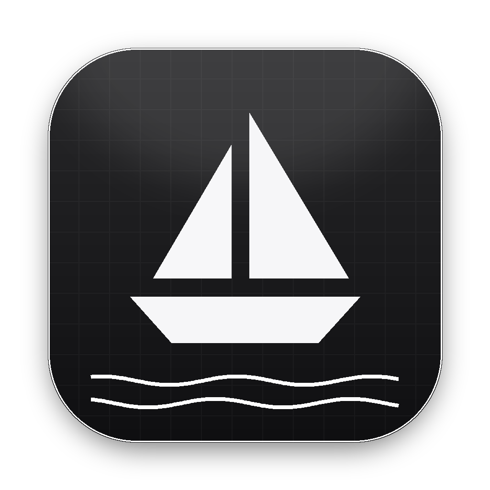

<p align="center">
  
</p>

<h1 align="center">Boat Deck</h1>

<p align="center">
  A native macOS app for managing <a href="https://boat.dev">boat.dev</a> cloud sandboxes:<br>
  launch and control VMs, drive coding agents, browse files, run commands, and manage environments,
  snapshots, webhooks and API keys without leaving your Mac.
</p>

---

## Features

| Area | What you can do |
| --- | --- |
| **Home** | Greeting, live counts (active sandboxes, credit, starts left, environments), recent sandboxes, fleet breakdown and an activity timeline of state changes. |
| **Sandboxes** | List or grid view with filters, search and sort. Create sandboxes with size, lifetime, environment, starting snapshot, env vars, setup script and an optional first agent prompt. Stop, resume, fork, extend, rename, snapshot or delete. |
| **Sandbox › Overview** | Live auto-stop countdown, billed usage, machine specs, SSH endpoint, Open URL, and every field the API returns. |
| **Sandbox › Agent** | Prompt Claude Code / Codex inside the sandbox, pick provider, model and effort, steer or interrupt a running turn, and follow the event log. If the agent isn't set up yet, it links you to the setup page. |
| **Sandbox › Terminal** | Run commands (streamed, wait-for-result, or detached) with history (↑/↓). |
| **Sandbox › Files** | Browse, view and edit text files, preview images, upload by drag and drop, download, rename and delete. |
| **Sandbox › Access** | Expose ports on public URLs, forward ports to localhost, open the browser desktop or noVNC, SSH in Terminal, and add SSH keys. |
| **Environments** | Access toggles, repositories, variables (with reveal), secret files, versions and upgrade. |
| **Snapshots** | Named snapshots (launch from, pull to the Mac, delete) and all snapshots with file trees. |
| **Webhooks / API keys** | Create, enable or disable, rotate and delete webhooks. Create scoped API keys (read-only, full sandbox, CI or admin), view 30-day usage, rotate and revoke. |
| **Account** | Balance, plan and trial state, concurrency, start rate limits, organizations and wallets, and zero data retention. |
| **Console** | Run any `boat` CLI command. Interactive ones (`ssh`, `login`) open in Terminal. |
| **Everywhere** | ⌘K command palette, a menu bar extra with quick actions, state-change notifications, light/dark/system themes, accent colours, and an optional glass/ambient look. |

The layout adapts to the window: the sidebar collapses to icons, columns reflow, inspector panes stack, and toolbars wrap, so content fits from about 720 pt wide up to full screen.

## Requirements

- macOS 14 Sonoma or later. The Liquid Glass effect needs macOS 26 or later; older systems use the standard blur material.
- Apple's Command Line Tools (`xcode-select --install`). Full Xcode is **not** required.
- A boat.dev API key. Optional: the [`boat` CLI](https://docs.boat.dev/quickstart), used for SSH, port forwarding, snapshot pulls, key and org management, and as a fallback when an API call fails.

## Build & install

```sh
git clone <this repo> boat-gui && cd boat-gui
./build.sh            # or: make
```

This compiles a release build, wraps it into `Boat Deck.app`, signs it ad-hoc, installs it to `~/Applications` and launches it. You can also double-click **Build Boat Deck.command** in Finder.

| Command | Does |
| --- | --- |
| `make` / `./build.sh` | Build, install and launch |
| `make install` / `./build.sh --no-open` | Build and install only |
| `make watch` | Rebuild every time a `.rebuild` file appears (handy for remote or automated edits) |
| `make clean` | Remove build products |

The app is ad-hoc signed. To share a build with someone else, sign it with a Developer ID and notarize it.

## First run

1. Paste a boat.dev API key into the welcome screen. Alternatively, use the in-app buttons to install the CLI, log in, and let it create a key.
2. The key is stored at `~/Library/Application Support/BoatDeck/credentials` (mode `0600`). Change it or sign out in **Settings › Account**.

### Keyboard shortcuts

| Keys | Action |
| --- | --- |
| ⌘K | Command palette (search sandboxes, actions, pages) |
| ⌘N / ⇧⌘N | New sandbox / quick launch |
| ⌘1 … ⌘8 | Jump to Home, Sandboxes, Environments, Snapshots, Webhooks, API Keys, Account, Console |
| ⌘R | Refresh |
| ⌘\\ | Toggle sidebar |
| ⌘, | Settings |
| ⌘↩ | Send prompt / launch sandbox |

## Project layout

```
Package.swift            SwiftPM executable target (macOS 14+)
build.sh                 build → bundle → sign → install
Resources/               Info.plist and the 1024 px app icon
scripts/dev-watch.sh     rebuild-on-trigger dev loop
Sources/BoatDeck/
  App.swift              @main scenes (window, Settings, menu bar extra) and commands
  Store.swift            AppState: polling, actions, activity log, preferences
  API.swift              REST client (JSON/NDJSON), errors, optional redacted trace log
  System.swift           credential file, Keychain migration, boat CLI bridge, Terminal launcher
  JSON.swift             lenient JSON value + Record helpers
  Theme.swift            colours, glass, ambient background, preferences, VState
  Components.swift       buttons, chips, status dots, gauges, toasts, fields, dialogs
  Layout.swift           width-aware Page/PageHeader, flat sections, MetricStrip, FlowLayout
  Shell.swift            root view, sidebar
  HomeView.swift         dashboard
  SandboxesView.swift    list/grid, quick actions, new-sandbox sheet
  SandboxDetail.swift    detail header, tabs, overview, access, snapshots
  AgentView.swift        agent prompts and event log
  TerminalFiles.swift    exec terminal and file browser/editor
  EnvironmentsView.swift environments
  LibraryViews.swift     snapshots, webhooks, API keys
  AccountView.swift      account/billing and CLI console
  Overlays.swift         command palette, onboarding, menu bar UI
  SettingsView.swift     settings window
```

## Implementation notes

- **No SwiftUI macros.** On the macOS 27 SDK, `@State`, `@Namespace` and friends are macros whose plugins ship only with full Xcode. The code therefore uses `VState` (a small property wrapper backed by `@StateObject`) and typealiases, so it builds with the Command Line Tools alone.
- **No `.repeatForever` animations.** Continuous motion (status pulse, spinners, shimmer, waves) is computed from `TimelineView` time. A repeating animation started from an ObservableObject change can leak into everything else updated in the same transaction. Timelines pause while the window is inactive.
- **Quiet polling.** Sandbox state is polled on an interval (Settings › General). Published state is only reassigned when it actually changes, so idle refreshes don't redraw the UI.
- **Lenient decoding.** Responses are decoded into a dynamic `JSON` type and read with fallbacks, so new or renamed API fields don't break the app. Every detail view also shows the raw fields.
- **API, then CLI.** Management actions try the REST API first and fall back to the equivalent `boat` command when the CLI is installed.
- **Agent events** are read from the paginated `/events` endpoint by polling (faster while an agent is working).

## Diagnostics

**Settings › Advanced › Log API traffic** writes requests and responses to `~/Library/Logs/BoatDeck/api-trace.log`, with keys, secrets, variable values and tokens redacted. Turn it off when you're done.

## Known limitations

- Agent prompting requires the provider (e.g. Codex or Claude Code) to be configured on boat.dev's Agents page. The app links there when the API reports it.
- Some API keys can't list conversations or the provider/model catalog. The app then falls back to default choices.
- A few write endpoints (environment variable and secret-file bodies, webhook update fields) are inferred from the docs and have CLI fallbacks.
